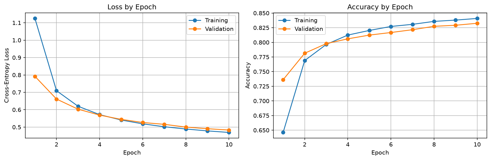
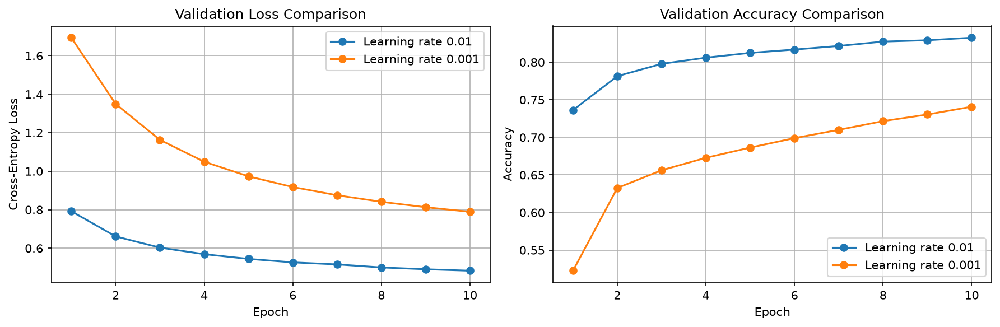
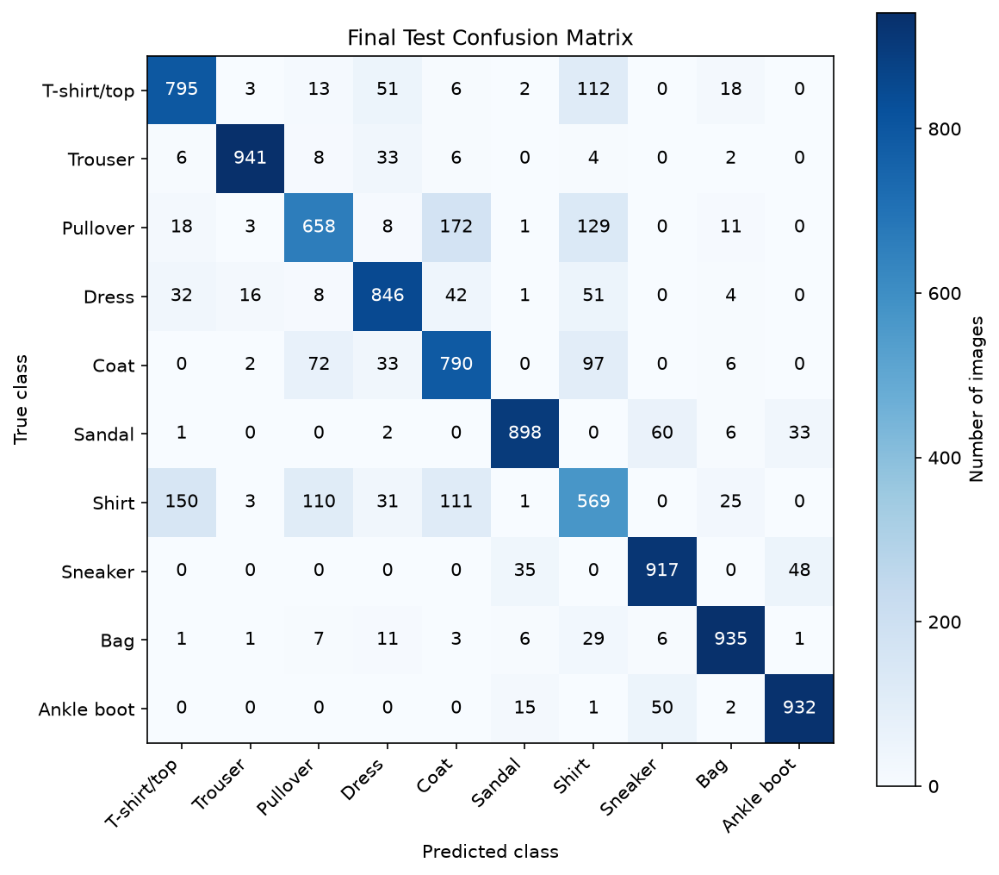
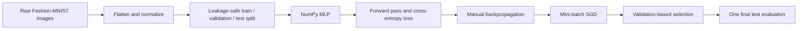

# NumPy MLP From Scratch: Fashion-MNIST

A small image-classification project built to understand how neural networks
learn. The model, loss, backpropagation, gradient descent, training loop, and
evaluation pipeline are written with NumPy. PyTorch is used only to download
Fashion-MNIST.

**Final test accuracy: 82.81%**

## Result At A Glance

| Item | Result |
| --- | ---: |
| Final test accuracy | **82.81%** |
| Final test loss | **0.4985** |
| Selected learning rate | `0.01` |
| Selected epoch | `10` |
| Best validation accuracy | 83.26% |

The final result comes from one held-out test evaluation after choosing the
learning rate with validation data.

## Visual Results

### Learning Curves



Training and validation loss both fell over 10 epochs. The small final gap
between training and validation accuracy suggests the model was generalizing
well rather than clearly overfitting.

### Learning-Rate Comparison



### Final Test Confusion Matrix



Rows are true classes and columns are predictions. Similar upper-body classes
are the hardest: `Shirt` has the lowest recall at 56.90% and is often confused
with T-shirts/tops, pullovers, and coats.

## What I Built



The model has one hidden layer:

```text
784 input pixels -> 128 hidden neurons + ReLU -> 10 class probabilities
```

The notebook implements:

- Manual `W1`, `b1`, `W2`, and `b2` initialization.
- ReLU, numerically stable softmax, and cross-entropy loss.
- Manual gradients: `dW1`, `db1`, `dW2`, and `db2`.
- Mini-batch SGD with batch size 128.
- A numerical gradient check to verify backpropagation.
- Training/validation learning curves, a controlled learning-rate comparison,
  and final test error analysis.

## Data Protocol

Fashion-MNIST contains 60,000 official training images and 10,000 official
test images across 10 clothing classes. The official training data is split
with seed 42 and saved for reproducibility.

| Split | Images | Purpose |
| --- | ---: | --- |
| Training | 55,000 | Learn weights and biases |
| Validation | 5,000 | Choose settings fairly |
| Test | 10,000 | One final generalization estimate |

Each grayscale $28 \times 28$ image is flattened into 784 values and scaled
from $[0, 255]$ to $[0, 1]$.

## Experiment Selection

The baseline and comparison used the same split, seed, model, batch size, and
10 epochs. Only the learning rate changed.

| Learning rate | Best validation loss | Best validation accuracy | Decision |
| ---: | ---: | ---: | --- |
| 0.01 | **0.4832** | **83.26%** | Selected |
| 0.001 | 0.7892 | 74.08% | Learned too slowly in 10 epochs |

The selected model was then evaluated once on the untouched official test set.
No settings were changed using test results.

## How To Run

Open [numpy_mlp_fashion_mnist.ipynb](numpy_mlp_fashion_mnist.ipynb) in VS Code
or Jupyter and run cells from top to bottom. The notebook downloads the dataset
if it is not already present.

To execute the full notebook from a terminal:

```bash
cd /home/qtg6528/AI/scratch_projects/numpy_mlp_fashion_mnist
/home/qtg6528/AI/scratch_projects/.venv/bin/jupyter nbconvert \
  --to notebook \
  --execute \
  --inplace \
  --ExecutePreprocessor.timeout=120 \
  numpy_mlp_fashion_mnist.ipynb
```

Supporting notes are available in [decisions.md](decisions.md) and
[flow.md](flow.md).

## Scope

This project intentionally does not use PyTorch autograd, PyTorch optimizers,
pretrained models, CNNs, dropout, batch normalization, or data augmentation.
The goal is to make the basic learning loop visible and understandable.

## Concepts Learned

| Concept | Meaning |
| --- | --- |
| Train / validation / test split | Training learns parameters, validation chooses settings, and test estimates final generalization. |
| Data leakage | Information from validation or test data must not influence training or model selection. |
| Weight and bias | Learnable numbers that control how inputs are transformed into predictions. |
| Forward pass | The calculation from image pixels to class probabilities. |
| ReLU | An activation that keeps positive values and changes negative values to zero. |
| Softmax | Converts raw class scores into probabilities that sum to one. |
| Cross-entropy loss | Penalizes low probability assigned to the true class. |
| Backpropagation | Calculates how each weight and bias contributed to the loss. |
| Gradient descent | Updates parameters in the direction that should reduce loss. |
| Mini-batch | A small group of images used for one efficient parameter update. |
| Epoch | One full pass through the training data. |
| Learning rate | Controls the size of each gradient-descent update. |
| Numerical gradient check | Confirms manual gradients match a finite-difference approximation. |
| Confusion matrix | Shows which true classes are mistaken for which predicted classes. |
